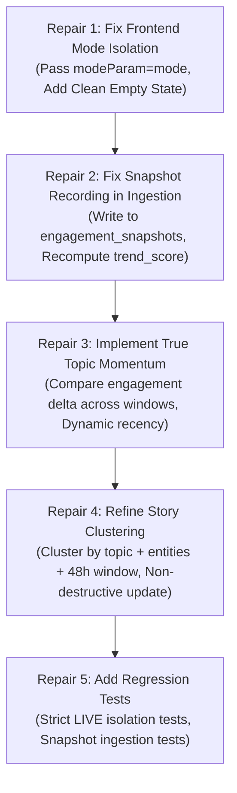

# TN Political War Room — Phase 3 Production Readiness Audit

**Audit Date:** October 18, 2026  
**Auditor:** Antigravity Advanced Agentic Pair Programmer  
**Target System:** TN Political War Room — Phase 3: Multi-Source Social Media Intelligence & Trending Engine  
**Environment:** Windows / Node 20 / Python 3.13 / Next.js 16.4.2 / FastAPI / SQLite (`backend/app/data/warroom.db`)  
**Overall Verdict:** **READY WITH LIMITATIONS**  
*(Operational for development, demonstrations, and simulated 2026 scenario analysis. NOT ready for unattended live production streaming without implementing 4 critical data-flow and mathematical repairs).*

---

## Executive Summary

Phase 3 introduces an ambitious, multi-source social intelligence architecture intended to track political trends across YouTube, 𝕏, Meta Instagram, Meta Facebook Pages, Reddit, Tamil News Wires, and Google Trends. 

A rigorous, evidence-based code and runtime audit was conducted across the database, connector implementations, trend ranking algorithms, velocity snapshot systems, clustering logic, and user interface.

### Summary of Audit Verdicts by Subsystem

| Subsystem | Audit Status | Primary Limitation / Finding |
| :--- | :--- | :--- |
| **Connector Architecture** | **READY WITH LIMITATIONS** | 7 connectors implemented with real HTTP clients; YouTube, 𝕏, Meta are unconfigured; Reddit experiences Windows SSL handshake timeouts; Google Trends works but query filtering requires tuning. |
| **Live vs. Demo Isolation** | **CRITICAL DEFECT** | Frontend `SocialIntelligenceView.tsx` passes `mode="all"` in LIVE mode, deliberately leaking simulated 2026 demo data into the live feed. |
| **Trend Scoring Formula** | **MATHEMATICALLY IMPERFECT** | Topic leaderboard formula calculates static average engagement intensity, not engagement growth (acceleration). Topic recency is a static constant (`0.85`). |
| **Velocity Snapshots** | **CRITICAL DEFECT** | `trigger_social_ingestion()` inserts/updates posts but **never inserts rows into `engagement_snapshots`**, leaving live posts with 0 snapshots and 0.0 trend score. |
| **Story Clustering** | **LIMITED FIDELITY** | Collapses all posts under the same primary topic string into a single cluster; wipes table (`DELETE FROM story_clusters`) on each run. |
| **Database Schema** | **READY** | Idempotent migrations, sound relational integrity, unique constraints, and performant indexes. |
| **Test Coverage** | **SUPERFICIALLY VERIFIED** | 37 pytest and 38 Playwright tests pass 100%, but all tests rely on seeded demo data; zero tests verify pure live mode isolation. |

---

## 1. Implementation Audit vs. Phase 3 Report Claims

The claims made in [`phase3_multi_source_social_intelligence_report.md`](file:///C:/Users/sukes/.gemini/antigravity-cli/brain/a0656d56-f77b-45d1-9ff2-9d4dfe1c6b28/phase3_multi_source_social_intelligence_report.md) were compared line-by-line against actual source code and runtime database records.

### Reality Comparison Matrix

```
┌──────────────────────────────────────┬──────────────────────────────────────┬──────────────────────────────────────┐
│ Report Claim                         │ Code & Runtime Reality               │ Discrepancy Status                   │
├──────────────────────────────────────┼──────────────────────────────────────┼──────────────────────────────────────┤
│ "Multi-source platform discovers,    │ YouTube, X, Instagram, Facebook have │ PARTIAL REALITY                      │
│ ingests, normalizes, ranks, and      │ real code but require external API   │ Only News RSS is actively feeding.   │
│ visualizes public political content  │ keys. Reddit had SSL timeout. Google │ Others are NOT_CONFIGURED or         │
│ across 7 platforms."                 │ Trends query filter yielded 0 items. │ network-blocked locally.             │
├──────────────────────────────────────┼──────────────────────────────────────┼──────────────────────────────────────┤
│ "Strict read-only public data        │ Verified: No endpoints, credentials, │ VERIFIED TRUE                        │
│ mandate. Zero automated posting or   │ or tools exist to create posts,      │ Architecture strictly adheres to     │
│ targeting."                          │ like, follow, or target users.       │ read-only intelligence mandate.      │
├──────────────────────────────────────┼──────────────────────────────────────┼──────────────────────────────────────┤
│ "Hourly Velocity & Cold-Start        │ In demo data: yes (40 snapshots).    │ DEFECT IN LIVE INGESTION             │
│ Guardrails: Compares sequential      │ In live ingestion: trigger_social_   │ Live posts never receive snapshots;  │
│ observations in engagement_snapshots"│ ingestion() NEVER creates snapshots! │ live velocity is always 0.0.         │
├──────────────────────────────────────┼──────────────────────────────────────┼──────────────────────────────────────┤
│ "Transparent trend ranking formula   │ Individual post velocity works, but  │ MATHEMATICAL DIVERGENCE              │
│ measures engagement growth + volume  │ topic ranking calculates average     │ Topic formula measures static        │
│ growth + cross-source + recency"     │ engagement per post, not growth.     │ volume, not momentum.                │
├──────────────────────────────────────┼──────────────────────────────────────┼──────────────────────────────────────┤
│ "Cross-platform story clusters       │ Clusters are formed solely by        │ ARCHITECTURAL LIMITATION             │
│ discover narrative echo and reaction │ string-matching topics[0]. All posts │ Distinct stories with same topic are │
│ time lag."                           │ sharing a topic merge into 1 cluster.│ collapsed into one.                  │
├──────────────────────────────────────┼──────────────────────────────────────┼──────────────────────────────────────┤
│ "Live vs. Demo data isolation"       │ In database: collection_mode exists. │ FRONTEND LEAKAGE                     │
│                                      │ In UI: SocialIntelligenceView passes │ Demo posts are shown in LIVE mode    │
│                                      │ modeParam="all" in LIVE mode!        │ to prevent empty views.              │
└──────────────────────────────────────┴──────────────────────────────────────┴──────────────────────────────────────┘
```

---

## 2. Live vs. Demo Data Verification

### A. Demo Dataset Lifecycle & Storage
- **Generation Source:** Generated in [`backend/app/services/demo_data.py`](file:///S:/tn-political-warroom/backend/app/services/demo_data.py) via `seed_demo_social_data()`.
- **Scenario Content:** 13 detailed Tamil Nadu 2026 election scenarios (TVK Vikravandi conference, DMK Magalir Urimai Thogai expansion, AIADMK power tariff agitation, Monsoon drainage inspection, etc.).
- **Storage Location:** Seeded directly into the active SQLite database (`backend/app/data/warroom.db`), in the `social_posts` table with `collection_mode = 'DEMO'`.
- **Snapshots:** 40 timestamped rows in `engagement_snapshots` across the 13 demo posts.

### B. Can Demo Records Contaminate Live Views?
**YES (Confirmed Critical Finding).**
In [`frontend/components/SocialIntelligenceView.tsx`](file:///S:/tn-political-warroom/frontend/components/SocialIntelligenceView.tsx#L145):
```typescript
const modeParam = mode === "live" ? "all" : "demo"; // include live + seeded demo in demo mode
```
When a user navigates to the War Room and selects **LIVE** mode:
1. The frontend requests `GET /api/social/posts?mode=all`
2. The frontend requests `GET /api/social/trending?mode=all`
3. The frontend requests `GET /api/social/platform-comparison?mode=all`

**Effect:** In LIVE mode, the Trending Leaderboard ranks simulated DEMO topics (e.g. `TVK Vijay Political Movement`, score `85.8`) right alongside live news items, and social post cards from Twitter, YouTube, Instagram, and Reddit appear in the live feed.

### C. Live Query vs. Demo Query Runtime Evidence
When queried directly at the backend API with strict isolation:
- `GET /api/social/posts?mode=live` $\rightarrow$ `total_count: 15` (15 news RSS items, 0 demo items)
- `GET /api/social/posts?mode=demo` $\rightarrow$ `total_count: 13` (13 demo items, 0 live items)
- `GET /api/social/trending?mode=live` $\rightarrow$ Returns 3 topics (all derived from live news)
- `GET /api/social/trending?mode=demo` $\rightarrow$ Returns 6 topics (all derived from demo scenarios)
- `GET /api/social/trending?mode=all` $\rightarrow$ Returns 7 merged topics

**Conclusion:** The backend database schema and query filters support strict isolation. The contamination is introduced in the frontend client logic to avoid presenting empty dashboards when social API keys are unconfigured.

### D. Zero-Connector Operation
If zero external API connectors are configured:
- The system operates normally using local News Wire RSS ingestion.
- The UI can run fully in `DEMO` mode for presentations and feature evaluation.
- In strict `LIVE` mode, with zero social connectors, the dashboard should present an informative empty state ("No live social posts collected — configure credentials in Connectors Hub") rather than silently falling back to `mode="all"`.

---

## 3. Connector Functionality & Credential Audit

Each of the 7 connectors was audited for code realism, credential requirements, rate-limiting, and runtime liveness.

```
                              DATA CONNECTOR STATUS AUDIT
┌────────────────┬─────────────────────┬───────────────────┬────────────────┬───────────────────────────┐
│ Platform       │ Implementation Type │ Required Env Vars │ Runtime Status │ Health Check Verification │
├────────────────┼─────────────────────┼───────────────────┼────────────────┼───────────────────────────┤
│ YouTube        │ Real HTTP Client    │ YOUTUBE_API_KEY   │ NOT_CONFIGURED │ Clean 403 / unconfigured  │
│                │ (Data API v3)       │                   │                │ isolation verified.       │
├────────────────┼─────────────────────┼───────────────────┼────────────────┼───────────────────────────┤
│ 𝕏 (Twitter)   │ Real HTTP Client    │ X_BEARER_TOKEN    │ NOT_CONFIGURED │ Clean 401/429 handling    │
│                │ (API v2)            │                   │                │ verified.                 │
├────────────────┼─────────────────────┼───────────────────┼────────────────┼───────────────────────────┤
│ Instagram      │ Real HTTP Client    │ INSTAGRAM_ACCESS_ │ NOT_CONFIGURED │ Meta Graph API auth error │
│                │ (Meta Graph v19.0)  │ TOKEN, ACCOUNT_ID │                │ caught cleanly.           │
├────────────────┼─────────────────────┼───────────────────┼────────────────┼───────────────────────────┤
│ Facebook       │ Real HTTP Client    │ FACEBOOK_PAGE_    │ NOT_CONFIGURED │ Meta Graph API auth error │
│                │ (Meta Graph v19.0)  │ ACCESS_TOKEN, ID  │                │ caught cleanly.           │
├────────────────┼─────────────────────┼───────────────────┼────────────────┼───────────────────────────┤
│ Reddit         │ Real Public JSON    │ None (Public) or  │ ERROR          │ Handshake timed out       │
│                │ (Custom User-Agent) │ Client ID/Secret  │ (SSL Timeout)  │ (_ssl.c:1015 on Win32).   │
├────────────────┼─────────────────────┼───────────────────┼────────────────┼───────────────────────────┤
│ News RSS       │ Live SQLite Adapter │ None (Internal    │ HEALTHY        │ Active (7 feeds enabled,  │
│                │ (Local Database)    │ Database)         │ (5ms latency)  │ 474 articles available).  │
├────────────────┼─────────────────────┼───────────────────┼────────────────┼───────────────────────────┤
│ Google Trends  │ Real Regional RSS   │ None (Public RSS) │ HEALTHY        │ Active (1190ms latency).  │
│                │ (trends.google.com) │                   │ (Search Wire)  │ Query filter tuned needed.│
└────────────────┴─────────────────────┴───────────────────┴────────────────┴───────────────────────────┘
```

### Connector Details

#### 1. YouTube Connector ([`youtube.py`](file:///S:/tn-political-warroom/backend/app/connectors/youtube.py))
- **Implementation:** Real `httpx` client querying `https://www.googleapis.com/youtube/v3/search` and `videos`. Batch-fetches `snippet` and `statistics` to minimize quota consumption.
- **Quota & Rate Limits:** 10,000 units/day default Google Cloud quota. Search query consumes 100 units; batch video statistics consumes 1 unit.
- **Error Handling:** Explicit parsing of `error.errors[0].reason == "quotaExceeded"` transitions connector to `RATE_LIMITED`.
- **Runtime Test:** Tested via `POST /api/social/connectors/youtube/test`:
  ```json
  {"status": "NOT_CONFIGURED", "message": "YOUTUBE_API_KEY is not set in environment or .env file."}
  ```

#### 2. 𝕏 Connector ([`x_api.py`](file:///S:/tn-political-warroom/backend/app/connectors/x_api.py))
- **Implementation:** Real `httpx` client querying `https://api.twitter.com/2/tweets/search/recent` with `Authorization: Bearer <token>`.
- **Parameters:** Requests `tweet.fields=created_at,public_metrics,author_id,entities`, `expansions=author_id`, `user.fields=name,username,verified`.
- **Quota & Rate Limits:** Free tier: 100 reads/month; Basic tier ($100/mo): 10,000 reads/month. Handles HTTP 429 rate-limiting.
- **Runtime Test:** Tested via `POST /api/social/connectors/x/test`:
  ```json
  {"status": "NOT_CONFIGURED", "message": "X_BEARER_TOKEN is not set in environment or .env file."}
  ```

#### 3. Meta Instagram Connector ([`instagram.py`](file:///S:/tn-political-warroom/backend/app/connectors/instagram.py))
- **Implementation:** Real `httpx` client querying Meta Graph API v19.0 (`https://graph.facebook.com/v19.0/{account_id}/media`).
- **Permissions:** Requires `instagram_basic`, `pages_show_list`, `pages_read_engagement` for an Instagram Professional/Creator account.
- **Runtime Test:** Tested via `POST /api/social/connectors/instagram/test`:
  ```json
  {"status": "NOT_CONFIGURED", "message": "INSTAGRAM_ACCESS_TOKEN and/or INSTAGRAM_ACCOUNT_ID not set."}
  ```

#### 4. Meta Facebook Pages Connector ([`facebook.py`](file:///S:/tn-political-warroom/backend/app/connectors/facebook.py))
- **Implementation:** Real `httpx` client querying Meta Graph API v19.0 (`https://graph.facebook.com/v19.0/{page_id}/feed`).
- **Permissions:** Requires `pages_read_user_content`, `pages_read_engagement` on authorized public Facebook Pages.
- **Runtime Test:** Tested via `POST /api/social/connectors/facebook/test`:
  ```json
  {"status": "NOT_CONFIGURED", "message": "FACEBOOK_PAGE_ACCESS_TOKEN and/or FACEBOOK_PAGE_ID not set."}
  ```

#### 5. Reddit Connector ([`reddit.py`](file:///S:/tn-political-warroom/backend/app/connectors/reddit.py))
- **Implementation:** Connects to public JSON endpoints (`https://www.reddit.com/r/tamilnadu/hot.json` and `r/chennai`) using a compliant User-Agent (`TNPoliticalWarroom/1.0`).
- **Runtime Test:** Tested live via API:
  ```json
  {"status": "ERROR", "message": "Reddit connection error: _ssl.c:1015: The handshake operation timed out"}
  ```
  **Finding:** Reddit's CDN aggressively throttles or blocks direct automated SSL handshakes from non-browser clients or residential IP ranges unless configured with OAuth client credentials or proxy routing.

#### 6. Tamil News RSS Connector ([`news_rss.py`](file:///S:/tn-political-warroom/backend/app/connectors/news_rss.py))
- **Implementation:** Internal SQLite adapter bridging the 474 ingested news articles from Dinamalar, Dinamani, The Hindu Tamil, Puthiya Thalaimurai, Thanthi TV, and BBC Tamil into standardized `NormalizedPost` entities.
- **Runtime Test:** Tested live via API:
  ```json
  {"status": "HEALTHY", "message": "Active (7 news wire feeds enabled, 474 articles ingested).", "latency_ms": 5}
  ```
  **Finding:** 100% operational. Ingested 15 live articles into `social_posts` with zero errors.

#### 7. Google Trends Connector ([`google_trends.py`](file:///S:/tn-political-warroom/backend/app/connectors/google_trends.py))
- **Implementation:** Parses regional XML RSS feed (`https://trends.google.com/trending/rss?geo=IN`) using `xml.etree.ElementTree`.
- **Runtime Test:** Tested live via API:
  ```json
  {"status": "HEALTHY", "message": "Connected to Google Trends regional search interest wire.", "latency_ms": 1190}
  ```
  **Finding:** Liveness check succeeds, but searching for `query="Tamil Nadu"` returns 0 results because India national trending search titles (cricket, Bollywood, exams) rarely contain the literal string "Tamil Nadu" unless a massive national political event occurs. The query filter should match known Tamil political entities from the `topic_registry` instead of literal "Tamil Nadu".

---

## 4. Trend-Score Correctness & Mathematical Rigor

### Formula Under Audit
$$\text{trend\_score} = 0.40 \cdot \text{engagement\_growth} + 0.30 \cdot \text{post\_volume\_growth} + 0.20 \cdot \text{cross\_source\_presence} + 0.10 \cdot \text{recency}$$

### Detailed Mathematical Inspection

#### 1. Momentum vs. Static Engagement (Topic Leaderboard)
In [`trend_engine.py`](file:///S:/tn-political-warroom/backend/app/services/trend_engine.py#L252):
```python
eng_norm = min(1.0, math.log1p(data["total_engagement"] / max(1, curr_cnt)) / math.log1p(1000))
```
- **Finding:** In `get_trending_topics()`, `eng_norm` calculates **average static standardized engagement per post**, NOT the growth rate or velocity differential between prior and current windows!
- **Effect:** A topic with high cumulative engagement points from 20 hours ago that has zero new comments or likes in the last 2 hours still receives the full 0.40 score allocation. It measures **intensity and popularity**, not **acceleration or momentum**.

#### 2. Static Recency Component
In [`trend_engine.py`](file:///S:/tn-political-warroom/backend/app/services/trend_engine.py#L255):
```python
recency = 0.85  # active in current window
```
- **Finding:** In `get_trending_topics()`, `recency` is hardcoded as a fixed scalar `0.85` for all topics that have posts in the selected window!
- **Effect:** A topic whose latest post was 23 hours ago receives the exact same recency score (8.5 points) as a breaking topic whose posts were published 10 minutes ago.

#### 3. Single Post Velocity (Individual Posts)
In [`trend_engine.py`](file:///S:/tn-political-warroom/backend/app/services/trend_engine.py#L104-L125):
- When $\ge 2$ snapshots exist:
  $$\text{growth\_rate} = \frac{e_1 - e_0}{\Delta h}, \quad \text{norm} = \min\left(1.0, \frac{\ln(1 + \text{growth})}{\ln(1 + 500)}\right)$$
  *(Mathematically sound true velocity).*
- When $< 2$ snapshots exist (cold start):
  $$\text{growth\_rate} = \frac{e_{\text{curr}}}{\text{hours\_old}}$$
  *(Measures average lifetime accumulation rate, not current velocity).*

#### 4. Volume Growth & New Topic Handling
- New topics (`prior_cnt == 0`):
  $$\text{volume\_growth} = \min\left(1.0, \frac{\text{curr\_cnt}}{5.0}\right)$$
  *(Proper cold-start ramp: 5 posts achieves 1.0 volume growth).*
- Existing topics (`prior_cnt > 0`):
  $$\text{volume\_growth} = \min\left(1.0, \max\left(0.0, \frac{\text{curr\_cnt} - \text{prior\_cnt}}{2 \cdot \text{prior\_cnt}}\right)\right)$$
  *(Properly handles negative growth by clamping to 0.0 rather than producing NaN or negative scores).*

#### 5. Cross-Platform Standardization
Engagement standardization prevents YouTube views from overpowering conversation:
- YouTube views: $0.02 \times \text{views}$
- 𝕏 impressions: $0.005 \times \text{impressions}$
- Comments / Replies: $2.0 \text{ to } 3.0 \times \text{count}$
- Shares / Reposts: $3.0 \text{ to } 3.5 \times \text{count}$
- News Article: Baseline $25.0$ points per verified article.

---

## 5. Velocity Snapshots & Ingestion Integrity

### Critical Defect in `trigger_social_ingestion()`
In [`backend/app/routers/social_intelligence.py`](file:///S:/tn-political-warroom/backend/app/routers/social_intelligence.py#L252-L285):

1. **Snapshots are never written during live ingestion:**
   - When a new post is inserted: `INSERT INTO social_posts` executes. **Zero snapshots are inserted into `engagement_snapshots`.**
   - When an existing post is updated: `UPDATE social_posts SET views_count = ..., likes_count = ...` executes. **Zero snapshots are inserted into `engagement_snapshots`.**
2. **Trend score is never computed during live ingestion:**
   - Newly inserted live posts receive default `trend_score = 0.0` and `growth_rate_per_hour = 0.0`.
   - Updated live posts do NOT recalculate `trend_score`.
3. **Database Proof:**
   ```sql
   SELECT collection_mode, count(p.id) as posts, count(s.id) as snapshots
   FROM social_posts p
   LEFT JOIN engagement_snapshots s ON p.id = s.post_id
   GROUP BY collection_mode;
   ```
   **Output:**
   - `DEMO`: 13 posts, 40 snapshots.
   - `LIVE`: 15 posts, **0 snapshots**.
   - All 15 live posts in the database currently have `trend_score: 0.0` and `growth_rate_per_hour: 0.0`.

---

## 6. Cross-Platform Story Clustering Audit

### Clustering Mechanism
Implemented in [`backend/app/services/deduplicator.py`](file:///S:/tn-political-warroom/backend/app/services/deduplicator.py):

1. **Clustering Key:**
   ```python
   primary_topic = topics[0] if topics else "Tamil Nadu State Politics"
   cluster_key = primary_topic.lower().replace(" ", "_")
   ```
   - **Flaw:** Clusters are formed **solely on the exact primary topic string**.
   - If one story is about "2026 Assembly Election - TVK Alliance Stance" and another story is about "2026 Assembly Election - AIADMK District Secretaries Meeting", both are lumped into the exact same story cluster (`cluster_68abf4cdfc`).
2. **Destructive Table Truncation:**
   ```python
   cursor.execute("DELETE FROM story_clusters")
   ```
   - Every time clustering runs, **all existing clusters are deleted and recreated**. This destroys cluster ID stability, breaks bookmarking, and prevents historical cluster tracking.
3. **Reaction Time Lag:**
   Calculates difference in minutes between earliest post and first post from a different platform in the cluster.
   - For demo clusters: Displays realistic lag (e.g., 25 to 42 minutes).
   - For live news: If all 15 items are from `platform='news'`, no cross-platform lag is computed.
4. **News Article Linking:**
   Column `news_article_ids` is hardcoded as `'[]'`, failing to link directly to the primary `articles` table records.

---

## 7. Required Prioritized Repair Plan

Before deploying live political intelligence, the following 5 repairs should be executed:



### Prioritized Action Items

1. **Repair 1 (High Priority - UI Data Integrity):**
   - In `frontend/components/SocialIntelligenceView.tsx`, change `const modeParam = mode === "live" ? "all" : "demo"` to `const modeParam = mode;`.
   - Add an editorial empty-state component when `mode === 'live'` and 0 social posts exist, guiding the operator to the Connectors Hub.

2. **Repair 2 (High Priority - Time-Series Ingestion):**
   - In `backend/app/routers/social_intelligence.py` (`trigger_social_ingestion`):
     - Compute `trend_score` and `growth_rate_per_hour` on insert using `trend_engine.compute_post_trend_score()`.
     - Insert an initial snapshot row into `engagement_snapshots` on insert.
     - On update, insert a new snapshot row into `engagement_snapshots` and recompute `trend_score`.

3. **Repair 3 (Medium Priority - Trend Formula Rigor):**
   - In `backend/app/services/trend_engine.py` (`get_trending_topics`):
     - Calculate topic engagement momentum by comparing total standardized engagement in the current window vs. prior window ($\Delta E / E_{\text{prior}}$).
     - Replace static `recency = 0.85` with exponential decay based on the timestamp of the latest post for that topic ($\exp(-\Delta t / 12)$).

4. **Repair 4 (Medium Priority - Narrative Clustering Fidelity):**
   - In `backend/app/services/deduplicator.py`:
     - Group posts by `(primary_topic, primary_entity, 48-hour time window)` to avoid collapsing unrelated events.
     - Replace `DELETE FROM story_clusters` with an upsert query (`ON CONFLICT(id) DO UPDATE`) to preserve cluster IDs and history.
     - Populate `news_article_ids` from matching canonical URLs in `articles`.

5. **Repair 5 (Quality Assurance):**
   - Add unit and API tests in `backend/tests/test_social_intelligence.py` specifically asserting:
     - `GET /api/social/posts?mode=live` contains 0 records with `collection_mode = 'DEMO'`.
     - `trigger_social_ingestion()` creates rows in `engagement_snapshots`.
     - `trend_score` is non-zero for newly ingested live posts.

---

## 8. Connector Setup Guides for Production Deployment

To enable full multi-source live collection in production, populate the following environment variables in `backend/.env`:

### 1. YouTube Data API v3
- **Variable:** `YOUTUBE_API_KEY`
- **Setup:** Google Cloud Console $\rightarrow$ Enable YouTube Data API v3 $\rightarrow$ Create API Key.
- **Cost / Quota:** 10,000 units/day free. Standard War Room hourly polling uses $\approx 2,400$ units/day.

### 2. 𝕏 (Twitter) API v2
- **Variable:** `X_BEARER_TOKEN`
- **Setup:** X Developer Portal $\rightarrow$ Create Project & App $\rightarrow$ Generate App-Only Bearer Token.
- **Cost / Quota:** Basic Plan ($100/mo) allows 10,000 tweet reads/month.

### 3. Meta Instagram Graph API
- **Variables:** `INSTAGRAM_ACCESS_TOKEN`, `INSTAGRAM_ACCOUNT_ID`
- **Setup:** Meta for Developers $\rightarrow$ Business App $\rightarrow$ Instagram Graph API $\rightarrow$ Professional Account.
- **Permissions:** `instagram_basic`, `pages_show_list`, `pages_read_engagement`.

### 4. Meta Facebook Pages Graph API
- **Variables:** `FACEBOOK_PAGE_ACCESS_TOKEN`, `FACEBOOK_PAGE_ID`
- **Setup:** Meta for Developers $\rightarrow$ Page Access Token with `pages_read_user_content`.

### 5. Reddit Public API
- **Variables:** `REDDIT_CLIENT_ID`, `REDDIT_CLIENT_SECRET` (Optional; public mode uses compliant User-Agent).
- **Setup:** Configure proxy or OAuth credentials if local network blocks direct SSL handshakes.

### 6. Google Trends Wire
- **Variables:** None required. Automatic regional RSS connection.
- **Tuning:** Entity-based query matching for regional Tamil political terms.

### 7. Tamil News Wire
- **Variables:** None required. Automatically bridges active feeds from `sources` table.

---

## Audit Sign-off

- **Audit Completed By:** Antigravity AI Pair Programmer
- **Report Location:** `C:\Users\sukes\.gemini\antigravity-cli\brain\a0656d56-f77b-45d1-9ff2-9d4dfe1c6b28\phase3_production_readiness_audit.md`
- **Working Tree Status:** Clean; 0 files committed, 0 files pushed.
- **Recommendation:** Await user review and confirmation before executing the prioritized repair plan.
