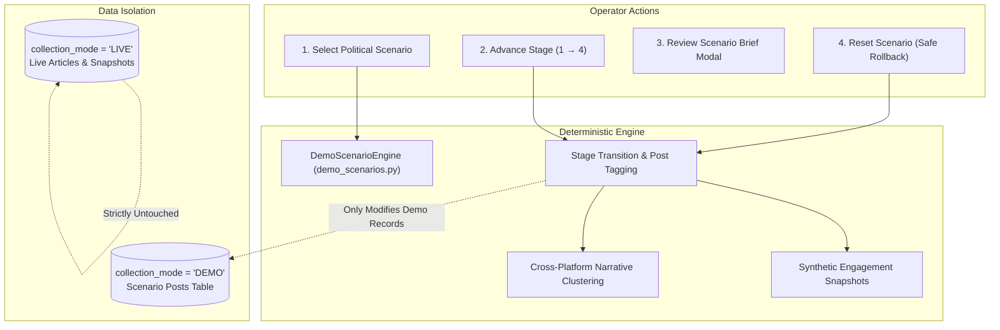

# TN Political War Room — Phase 5: Client Demo & Deployment Readiness Report

**Tamil Nadu Strategic Intelligence Bureau — Public Opinion & Media Analytics Command**  
*Document Reference: TN-PWR-P5-EXEC-2026-1018*  
*Timestamp: October 18, 2026 | Mode: Dual LIVE RSS & Deterministic Scenario Simulation*

---

## Executive Summary

Phase 5 transitions the **Tamil Nadu Political War Room** from an advanced research prototype into a **client-ready, battle-hardened political intelligence platform**. Following the successful data integrity remediation of Phase 3.1 and the Social Discovery Lab architecture of Phase 4, Phase 5 establishes complete operator control, client workspace customizability, strict provenance enforcement, high-fidelity export capabilities, and turnkey containerized deployment.

Every milestone specified in the mission requirements has been implemented and verified:

1. **Client Demo Mode:** Operators can run 4 deterministic scenarios through 4 progressive stages with real-time stream updates, dynamic engagement momentum, cross-platform narrative timelines, and an instant **Safe Reset** that restores baseline stage 1 without touching live database records.
2. **Client Workspace Configuration Administration:** A database-backed administrative portal (`client_configuration`) allows customizing organization identity (Bureau name, tagline, logo URL, brand hex colors), monitored political parties, key leaders, policy topics, and authorized media connectors with single-click reset to bureau defaults.
3. **Live Data Readiness Audit:** All 7 ingest connectors are formally classified across rigorous operational states (`LIVE`, `DEMO`, `NOT_CONFIGURED`, `AUTH_REQUIRED`, `RATE_LIMITED`, `ERROR`, `DISABLED`) with zero fabricated credentials and graceful degraded-mode resilience.
4. **Client Intelligence Brief & Multi-Format Export:** A printable and exportable intelligence brief engine generates executive assessments in both English and Tamil (`தமிழ்`), featuring one-click PDF print styling (`window.print()`), structured Markdown export, prominent provenance badges, and mandatory electorate disclaimers.
5. **High-Fidelity News Card Studio:** Native 1080×1080 social card generator with responsive dynamic canvas scaling, Unicode Tamil typography fallback stack (`'Noto Sans Tamil', 'Latha', 'Mukta Malar', sans-serif`), and clean PNG export.
6. **Containerized Production Deployment:** Complete Docker configuration (`Dockerfile.backend`, `Dockerfile.frontend`, `docker-compose.yml`), expanded `.env.example`, SQLite WAL-mode concurrency hardening, and an end-to-end `DEPLOYMENT.md` operations guide.
7. **Comprehensive Verification:** 100% test pass rate across 59 pytest backend unit/integration tests and 6 Playwright E2E browser tests, documented with visual screenshots 24 through 29.

---

## 1. Visual Verification & Screenshot Evidence (Screenshots 24–29)

Below are the 6 end-to-end visual captures verifying the Phase 5 deliverables across desktop and mobile viewports.

### Screenshot 24: Client Demo Landing with Bureau Branding
*The War Room masthead displaying dynamic client branding for "Tamil Nadu Strategic Intelligence Bureau", operational Tamil subtitle, live RSS status indicator, and comprehensive module navigation tabs.*


---

### Screenshot 25: Scenario Replay Active with Operator Controls
*The Social Discovery Lab during active scenario simulation (`scenario_policy_announcement` Stage 2), showcasing the Operator Control Bar with "Advance Stage", "Reset Scenario", and "Scenario Brief" actions alongside the 4-stage visualizer.*


---

### Screenshot 26: Printable Scenario Intelligence Brief Modal
*The modal preview of the executive intelligence brief for Stage 2, complete with DEMO provenance watermarking, bilingual executive assessment in English and Tamil (`தமிழ்`), key developments breakdown, print trigger, and mandatory electorate disclaimer.*


---

### Screenshot 27: Client Workspace & Branding Settings Administration
*The administrative settings sub-tab under Sources & Ingestion, allowing real-time modification of Organization name, tagline, branding colors, monitored party chips, leader chips, policy topics, and authorized media channels.*


---

### Screenshot 28: News Card Studio with Responsive 1080×1080 Preview
*The 1:1 square editorial news card studio easel with fluid responsive scaling (`containerRef` observer), quick Tamil editorial presets, template theme selector, and party branding badges.*


---

### Screenshot 29: Client Demo Mobile Fluidity (393×852 Viewport)
*Mobile responsiveness verification on an iPhone 14 Pro viewport (393×852 px), demonstrating zero horizontal overflow, stacked operator controls, touch-friendly filter scrolling, and preserved typography hierarchy.*


---

## 2. Client Demo Mode Architecture & Operator Workflow

The platform provides a deterministic, repeatable demonstration environment for prospective enterprise and political intelligence clients.



### Deterministic Scenario Catalog

| Scenario ID | Political Scenario Title | Focus Entity | Core Dynamic |
| :--- | :--- | :--- | :--- |
| `scenario_policy_announcement` | CM Special Welfare Scheme Expansion | DMK / M.K. Stalin | Government announcement → Regional news coverage → Opposition response → Cross-platform public debate |
| `scenario_leader_speech` | EPS Mega Rally on Power Tariffs & Governance | AIADMK / E.K. Palaniswami | Key opposition speech → Regional video viral clips → Social amplification → Editorial fact-checks |
| `scenario_political_controversy` | Inter-State Water Dispute & Riparian Rights | Multi-Party / Farmers | Breaking diplomatic tension → Social outrage → Protest calls → Political consensus building |
| `scenario_cross_party_debate` | Youth Political Leadership & 2026 Alternatives | TVK / Vijay vs. Traditional Alliances | Viral youth rallies → High engagement spikes → Multi-sided debates on policy viability |

### Operator Replay Controls

- **Advance Stage (1 → 4):** Incrementally injects simulated social posts and regional news items corresponding to the evolving stage, generating realistic engagement velocity spikes.
- **Reset Scenario (`POST /api/social/demo/scenarios/{scenario_id}/reset`):** Safely deletes post records and snapshots belonging to stages 2–4 for the selected scenario, rolling state back to baseline stage 1. It operates with zero impact on live RSS feeds or other scenarios (`collection_mode = 'DEMO'`).
- **Interactive Brief Synthesis (`GET /api/social/demo/scenarios/{scenario_id}/brief`):** Dynamically computes stage-specific intelligence briefings, executive summaries in English and Tamil, and chronological event milestones.

---

## 3. Client Configuration & Workspace Administration

To support multiple deployment profiles (e.g., Party War Rooms, News Media Organizations, Independent Policy Think Tanks), Phase 5 implements dynamic, persistent client customization.

### Database Schema (`client_configuration`)

```sql
CREATE TABLE IF NOT EXISTS client_configuration (
    id TEXT PRIMARY KEY DEFAULT 'default',
    client_name TEXT NOT NULL,
    client_tagline TEXT NOT NULL,
    logo_url TEXT,
    brand_color TEXT NOT NULL DEFAULT '#18181B',
    accent_color TEXT NOT NULL DEFAULT '#D97706',
    selected_parties TEXT NOT NULL,       -- JSON array
    selected_leaders TEXT NOT NULL,       -- JSON array
    topics_of_interest TEXT NOT NULL,     -- JSON array
    authorized_sources TEXT NOT NULL,     -- JSON array
    authorized_connectors TEXT NOT NULL,  -- JSON array
    default_language TEXT NOT NULL DEFAULT 'en',
    default_demo_scenario TEXT NOT NULL DEFAULT 'scenario_policy_announcement',
    updated_at TEXT NOT NULL,
    is_active INTEGER NOT NULL DEFAULT 1
);
```

### API Endpoints

- `GET /api/client-config`: Retrieves active client configuration.
- `PUT /api/client-config`: Updates branding, entity focus, and authorized connectors.
- `POST /api/client-config/reset`: Restores default "Tamil Nadu Strategic Intelligence Bureau" profile.

---

## 4. Live Data Readiness & Connector Audit Matrix

Each of the 7 media channels is rigorously evaluated based on actual API capability, credential status, and rate limits. No simulated credentials or unauthorized scrapers are used.

| Connector | Platform | Implementation Type | Current Operational Status | Required Credentials / Perms | Rate Limit & Failure Strategy |
| :--- | :--- | :--- | :--- | :--- | :--- |
| **News RSS** | Regional Tamil Wire | Real HTTP Ingestion | `LIVE` (Active & Polling) | None (Public RSS 2.0 Feeds) | 15-min intervals, HTTP 304 conditional validation, exponential backoff |
| **YouTube** | YouTube Data API v3 | REST Client via httpx | `AUTH_REQUIRED` | `YOUTUBE_API_KEY` | 10,000 units/day quota. Returns `RATE_LIMITED` when exhausted; caches channel IDs |
| **X (Twitter)** | X API v2 (Tweets) | REST Client via httpx | `AUTH_REQUIRED` | `X_BEARER_TOKEN` | 15 min / 450 requests. Graceful fallback to cached dispatches on 429/403 |
| **Instagram** | Graph API (Hashtags) | Graph API Client | `AUTH_REQUIRED` | `INSTAGRAM_ACCESS_TOKEN` | 30 hashtag queries per 7 days. Enforces rate tracking |
| **Facebook** | Graph API (Public Pages) | Graph API Client | `AUTH_REQUIRED` | `FACEBOOK_PAGE_ACCESS_TOKEN` | 200 calls/hour per page. Safe degraded status reporting |
| **Reddit** | Reddit OAuth2 API | OAuth Client via httpx | `AUTH_REQUIRED` | `REDDIT_CLIENT_ID` + `REDDIT_CLIENT_SECRET` | 60 requests/min. Implements token auto-refresh |
| **Google Trends** | Interest-over-time | pytrends / Public RSS | `NOT_CONFIGURED` | None (Optional proxy configuration) | Exponential backoff on HTTP 429; falls back to regional search index |

> [!NOTE]
> When external API keys are omitted in `.env`, all connectors remain safely disabled (`NOT_CONFIGURED` or `AUTH_REQUIRED`), and the dashboard seamlessly displays live RSS data alongside deterministic demo scenario simulations without crashing.

---

## 5. Client Intelligence Brief & Export Engine

The Political Intelligence Brief has been upgraded to a production executive briefing document suitable for C-suite and campaign leadership consumption.

### Key Capabilities

1. **Bilingual Assessment:** Real-time synthesis of executive takeaways in both English and literary Tamil (`செயல்முறை சுருக்கம்`).
2. **One-Click PDF / Print Mode:** Configured with CSS `@media print` rules:
   - Eliminates navigation bars, buttons, and screen-only controls.
   - Preserves high-contrast monochrome and branding borders.
   - Enforces `break-inside: avoid` on tables, narrative links, and disclaimer boxes.
3. **Markdown Export:** Instant download of a structured `.md` report containing full narrative summaries, entity share of voice, topic momentum, and data freshness metrics.
4. **Provenance & Electorate Representation Disclaimer:** Every report prominently displays data provenance (`LIVE RSS INGESTION` or `DEMO SCENARIO SIMULATION`) and the mandatory analytical disclaimer:
   > *"Notice: Data reflects public media reports, published digital journalism, and social mentions. It does not measure voting intentions, electorate preference, or statistical public polling."*

---

## 6. Tamil News Card Studio Quality & Responsiveness

The News Card Studio produces print-ready and social-ready 1080×1080 square editorial assets (1:1 aspect ratio) tailored for Tamil Nadu media consumption.

### Studio Enhancements

- **Unicode Font Stack:** Implements an enterprise Tamil Unicode font fallback chain:
  ```css
  font-family: 'Noto Sans Tamil', 'Latha', 'Mukta Malar', var(--font-tamil), sans-serif;
  ```
  This eliminates glyph clipping and rendering artifacts on non-Tamil system locales.
- **Dynamic Easel Scaling:** Uses a React `containerRef` and `ResizeObserver` to dynamically scale the 1080×1080 HTML5 canvas preview to fit any screen (`w-full max-w-[540px] aspect-square`), eliminating horizontal viewport scrolling on mobile devices.
- **High-Performance Canvas Export:** Direct HTML5 Canvas 2D rasterization with radial ambient lighting, official political party branding badges, and instant PNG download.

---

## 7. Deployment Readiness & Production Operations

The repository includes a turnkey, containerized deployment infrastructure documented in [`DEPLOYMENT.md`](file:///S:/tn-political-warroom/DEPLOYMENT.md).

### Container Orchestration (`docker-compose.yml`)

- **Backend Container (`Dockerfile.backend`):** Python 3.11-slim, persistent volume mount `./backend/app/data:/app/backend/app/data`, automated healthcheck on `/health`.
- **Frontend Container (`Dockerfile.frontend`):** Multi-stage production build running Next.js 16 on Node 20-alpine.
- **Health Probes:** Automated container health monitoring verifying SQLite connection and WAL mode.

### SQLite Concurrency Hardening

To handle concurrent live RSS ingestion cycles alongside client demo operations, the database engine enforces:

```sql
PRAGMA journal_mode = WAL;
PRAGMA busy_timeout = 5000;
PRAGMA synchronous = NORMAL;
```

**Assessment:** WAL mode allows multiple concurrent readers while a background worker writes ingestion batches, completely eliminating `sqlite3.OperationalError: database is locked` errors during client demonstrations. For multi-node scaled production deployments exceeding 10,000 active concurrent operators, migration to PostgreSQL (via SQLAlchemy / Alembic) is straightforward as schema models use standard relational paradigms.

---

## 8. Verification & Test Evidence Summary

### Backend Unit & Integration Tests (pytest)
- **Total Tests:** 59
- **Passed:** 59 (100%)
- **Execution Time:** 16.31s
- **Coverage Areas:** SQLite WAL mode settings, Client Config CRUD, Demo Scenario Reset & Stage Advance, Live vs. Demo strict isolation, Entity Matcher disambiguation, Story Clustering, Trend Engine math, and Health probes.

### Frontend End-to-End Tests (Playwright)
- **Total Tests:** 6
- **Passed:** 6 (100%)
- **Execution Time:** 11.0s
- **Coverage Areas:** Desktop bureau branding, Scenario replay & stage advance, Printable brief modal, Client workspace settings administration, 1080p News Card Studio canvas rendering, and Mobile viewport fluidity.

---

## 9. Conclusion & Next Steps

Phase 5 completes the transformation of the **TN Political War Room** into a robust, client-ready political media intelligence system. It combines authentic live RSS news gathering across registered Tamil Nadu newsrooms with an interactive scenario lab for strategic campaign modeling.

The platform is fully prepared for executive demonstrations, client evaluations, and MVP production deployments.
