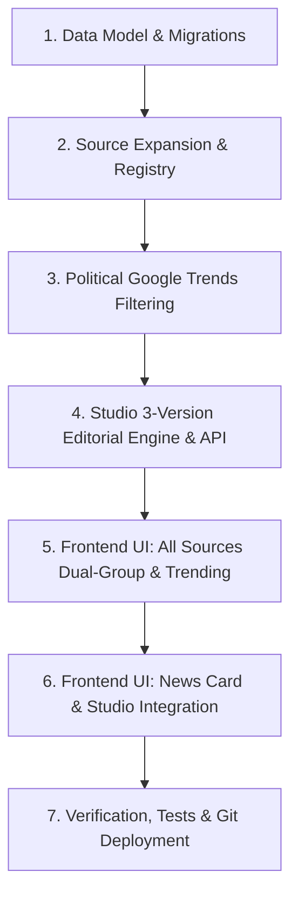

# TN Political Warroom — Platform Corrections & Feature Updates Plan

## 1. Objectives & Architectural Preservation
- Expand source monitoring from news channels alone to dual distinct pillars: **News Media** (`NEWS_MEDIA`) and **Political Influencers & Social Media** (`INFLUENCER` / `SOCIAL_MEDIA`).
- Retain all Phase 4 **Social Discovery Lab** capabilities without alteration.
- Enforce **strict political-only filtering** on Google Trends (Tamil Nadu parties, leaders, election, alliances, policy).
- Ensure accurate attribution (`source_name`, `source_type`, `platform`, `url`, `published_at`) across all UI cards and data streams.
- Reorganize All Sources into **Group A (News Media)** and **Group B (Influencers & Social Media)** with right-side Trending Now panel showing originating categories (`News Media`, `Influencers`, `Social Media`, `Google Trends`).
- Build an editorial engine for **Studio**:
  - **Version 1:** Summarized News (factual, concise).
  - **Version 2:** Detailed News (deep context, facts preserved, missing vs confirmed distinguished).
  - **Version 3:** Social Media / Influencer Format (hook, political context, factually accurate).
- Provide **Editorial Selection & Finalization**: users can edit and mark one version as `FINAL`, persisting to Neon PostgreSQL / SQLite across refreshes keyed by `article_id`.
- Zero automatic publishing to social media.

---

## 2. Implementation Phases

### Phase 1: Database & Migrations
- Add `article_editorial_versions` table to `neon_migrations.py` and `migrations.py`.
- Add `source_type` and `platform` columns to `sources`, `articles`, and `social_posts`.
- Ensure dual PostgreSQL/SQLite connection in `db.py` handles the new tables and queries.

### Phase 2: Source Expansion & Registry
- Add `SourceType` enum in `models.py`.
- Add curated Tamil political influencer and creator sources (`savukku_media`, `maridhas_official`, `redpix_24x7`, `aadhan_tamil`, `gunasekaran_news`, `nakkheeran_tv`) to `DEFAULT_SOURCES`.
- Update `NewsService` to attach `source_type` and `platform` to all articles.

### Phase 3: Google Trends Political-Only Filtering
- Update `GoogleTrendsConnector` to validate queries and RSS items against TN political entities and whitelist.
- Suppress entertainment, sports, cricket, and cinema items lacking political relevance.
- Tag trends with originating categories (`News Media`, `Influencers`, `Social Media`, `Google Trends`) in `trend_engine.py`.

### Phase 4: Studio 3-Version Editorial Engine
- Implement `GET /api/news/{article_id}/editorial-versions` and `POST /api/news/{article_id}/editorial-final`.
- Automatically generate 3 distinct versions when an article is first viewed in Studio: Summarized News, Detailed News, Social Media Format.
- Save user edits and `FINAL` status by `article_id`.

### Phase 5 & 6: Frontend UI Enhancements
- Update `ArticleCard.tsx` with category badges (`News Media` vs `Influencer`), platform icons, and article ID routing to Studio.
- Update `SourceManagementView.tsx`: split sources into **Group A (News Media)** and **Group B (Influencers & Social Media)**, with a right-hand Trending Now panel.
- Update `NewsCardStudio.tsx`: 3-version comparison, in-place editing, "Select as Final Output" button, `FINAL` status badge, and persistence.

### Phase 7: Verification & Deployment
- Run backend unit and integration test suites.
- Run frontend Next.js production build.
- Review git diff (verify zero secrets) and push to `origin/main`.
