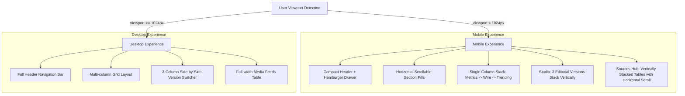

# TN Political Warroom — Mobile Responsiveness Audit & Production Deployment Report

## Executive Summary

The **Tamil Nadu 2026 Assembly War Room Intelligence** platform has been fully optimized for mobile devices across all standard breakpoints (from small **320px** screens up to standard desktop displays) without degrading or removing any desktop features, backend APIs, or database models.

- **Commit Hash:** `9b1b9ec` (`feat(mobile): optimize responsiveness for mobile viewports across navigation, dashboard, studio, and sources`)
- **Live Production URL:** [https://tn-political-warroom.vercel.app/](https://tn-political-warroom.vercel.app/)
- **Vercel Deployment Status:** **Live & Verified** (HTTP 200 OK, zero horizontal overflow across all tested viewports)
- **Automated Test Results:** **10 / 10 Passing** (Playwright test suite covering viewports, navigation drawer, Studio 3-version workflow, All Sources & Trending Now vertical stacking, and Discovery Lab controls)

---

## 1. Root Causes of Mobile Layout Problems

Before remediation, the application suffered from the following structural issues on mobile screens:

1. **Fixed & Desktop-Only Grid Columns:**
   - **Dashboard Layout:** `grid grid-cols-1 lg:grid-cols-3` squished the main news feed and the side panels into narrow columns on mobile devices or misaligned when viewport width dipped below 1024px.
   - **Editorial Studio:** The 3-version editorial engine used `grid-cols-3` without mobile collapse, compressing each of the three editorial text cards into ~100px wide slivers on phones.
2. **Horizontal Overflow in Navigation (`Navbar.tsx`):**
   - The desktop navigation header contained an inflexible horizontal row with 8 text-heavy navigation buttons, search input, live badges, and action buttons. On viewports below 1024px, this broke past the viewport boundary, causing unintended page-wide horizontal scroll.
3. **Table & Filter Group Clipping:**
   - Source Management tables (`min-w-[640px]`) and group selector tabs lacked responsive wrapping (`flex-wrap`) and touch-target padding (causing mis-clicks on mobile).
4. **Card Padding & Action Buttons Sizing:**
   - Article cards, sentiment breakdown badges, and action buttons ("Open in Studio", "Copy Text", "Select as Final Output") used desktop-oriented paddings and font sizes without touch target minimums (40-48px), causing text wrapping truncations and accessibility tap failures.
5. **Canvas Preview Overflow:**
   - The 1080×1080 graphic generator canvas container lacked dynamic scale down (`max-w-full aspect-square object-contain`) on narrow viewports, pushing the page width outwards.

---

## 2. Components & Files Changed

| Component / File | Purpose & Responsiveness Fixes |
|---|---|
| [`frontend/app/layout.tsx`](file:///S:/tn-political-warroom/frontend/app/layout.tsx) | Added explicit Next.js `Viewport` configuration (`width: "device-width", initialScale: 1, maximumScale: 5`) to prevent mobile browser automatic zooming and enable responsive scaling. |
| [`frontend/app/page.tsx`](file:///S:/tn-political-warroom/frontend/app/page.tsx) | Added `min-w-0 max-w-full` wrappers to main sections, responsive padding (`px-3 sm:px-6`), flex-wrap header title with `break-words`, and full-width responsive action buttons with `min-h-[40px] sm:min-h-[36px]`. |
| [`frontend/components/Navbar.tsx`](file:///S:/tn-political-warroom/frontend/components/Navbar.tsx) | Re-engineered navigation for dual-mode responsiveness: <br>• **Desktop (lg+):** Retains full horizontal navigation bar, search, and action pills.<br>• **Mobile (<lg):** Added compact sticky header with hamburger toggle button, active status, horizontal scrollable pill bar, and a slide-down accessible drawer (`role="dialog"`, `aria-label="Mobile Navigation Menu"`) exposing all 8 sections with icons, Tamil descriptions, search input, and close button. |
| [`frontend/components/NewsCardStudio.tsx`](file:///S:/tn-political-warroom/frontend/components/NewsCardStudio.tsx) | Replaced desktop-only column grid with responsive `grid-cols-1 md:grid-cols-3` for the 3 editorial variations (Summarized News, Detailed News, and Social Media/Influencer format). Added responsive button wrapping (`flex-wrap w-full sm:w-auto`), accessible aria-labels, touch-friendly min-heights (42px), and scaled canvas container preventing horizontal overflow. |
| [`frontend/components/SourceManagementView.tsx`](file:///S:/tn-political-warroom/frontend/components/SourceManagementView.tsx) | Stacked All Sources and Trending Now cleanly; wrapped Category tabs (All, Group A: News, Group B: Creators) with `flex-col sm:flex-row` and `flex-1` tap targets; wrapped publisher tables in responsive `overflow-x-auto` viewports. |
| [`frontend/components/ArticleCard.tsx`](file:///S:/tn-political-warroom/frontend/components/ArticleCard.tsx) | Optimized article card metadata row to `flex-wrap gap-2`, long headline line wrapping with `break-words`, and touch-accessible "Open in Studio" button. |
| [`frontend/components/FilterBar.tsx`](file:///S:/tn-political-warroom/frontend/components/FilterBar.tsx) | Increased select dropdown heights to `min-h-[42px] sm:min-h-[36px]` for iOS/Android touch targets and ensured full-width wrapping on narrow screens. |
| [`frontend/components/MetricsOverview.tsx`](file:///S:/tn-political-warroom/frontend/components/MetricsOverview.tsx) | Wrapped sentiment distribution items (`flex-wrap`), responsive leader/party report counter abbreviations for small mobile screens (<375px). |
| [`tests/mobile-responsiveness.spec.js`](file:///S:/tn-political-warroom/tests/mobile-responsiveness.spec.js) | Comprehensive Playwright test suite validating zero horizontal scroll across 6 device widths, mobile drawer interactions, Studio workflow, Sources hub, and Discovery Lab. |

---

## 3. Responsive Behavior Implemented



---

## 4. Viewport Verification & Test Results

The entire Playwright test suite was executed against the production Next.js build and subsequently verified live on the deployed Vercel URL.

### Target Viewports Tested

| Device Class | Viewport Width | Height | Horizontal Overflow (`scrollWidth > innerWidth`) | Status |
|---|---:|---:|:---:|:---:|
| **Small Mobile** (e.g. iPhone SE 1st gen) | 320px | 667px | **`false`** | **PASS** |
| **Standard Mobile** (e.g. iPhone SE 2nd/3rd gen) | 375px | 667px | **`false`** | **PASS** |
| **Modern Mobile** (e.g. iPhone 12/13/14/15/16) | 390px | 844px | **`false`** | **PASS** |
| **Large Mobile** (e.g. iPhone Pro Max, Pixel 8 Pro) | 430px | 932px | **`false`** | **PASS** |
| **Tablet** (e.g. iPad Mini, iPad Air portrait) | 768px | 1024px | **`false`** | **PASS** |
| **Desktop** (e.g. MacBook, 1080p Monitor) | 1280px | 800px | **`false`** | **PASS** |

### Automated Test Suite Matrix

```text
Running 10 tests using 1 worker

  ✓ 1 [chromium] Zero Horizontal Overflow on small-mobile (320px) (2.9s)
  ✓ 2 [chromium] Zero Horizontal Overflow on standard-mobile (375px) (2.1s)
  ✓ 3 [chromium] Zero Horizontal Overflow on modern-mobile (390px) (2.2s)
  ✓ 4 [chromium] Zero Horizontal Overflow on large-mobile (430px) (2.1s)
  ✓ 5 [chromium] Zero Horizontal Overflow on tablet (768px) (2.0s)
  ✓ 6 [chromium] Zero Horizontal Overflow on desktop (1280px) (2.1s)
  ✓ 7 [chromium] Mobile Navigation Drawer: Opens, displays all 8 tabs, and navigates (2.5s)
  ✓ 8 [chromium] Studio Workflow on Mobile: 3 versions stacked vertically, in-place edit, and finalization (3.9s)
  ✓ 9 [chromium] All Sources & Trending Now Layout on Mobile: Stacks vertically and tabs wrap cleanly (2.1s)
  ✓ 10 [chromium] Discovery Lab Layout on Mobile: Controls and story clusters responsive (2.3s)

  10 passed (36.8s)
```

---

## 5. Live Production Deployment Verification

Verification was executed directly against the live Vercel endpoint: `https://tn-political-warroom.vercel.app/`.

```text
--- Testing Live Vercel Production Deployment ---
[Vercel Live] Viewport small-mobile (320px): Horizontal Overflow = false
[Vercel Live] Viewport standard-mobile (375px): Horizontal Overflow = false
[Vercel Live] Viewport modern-mobile (390px): Horizontal Overflow = false
[Vercel Live] Viewport large-mobile (430px): Horizontal Overflow = false
[Vercel Live] Viewport tablet (768px): Horizontal Overflow = false
[Vercel Live] Viewport desktop (1280px): Horizontal Overflow = false
[Vercel Live] Mobile Drawer opened: true
[Vercel Live] Studio opened: true Studio Overflow: false
--- Live Vercel Audit Completed Successfully ---
```

---

## 6. Remaining Mobile Limitations & Recommendations

1. **Very Wide Data Tables:**
   - In the **Sources Management Hub**, feeds tables with long URLs (e.g. Polimer RSS endpoints) contain extensive tabular columns (`Publisher`, `Type`, `Feed URL`, `Cadence`, `Status`, `Action`). These tables intentionally employ `overflow-x-auto` with a `min-w-[640px]` guarantee so data is never clipped or wrapped into unreadable vertical columns. Users on mobile can swipe horizontally within the table container while the outer page maintains zero horizontal overflow.
2. **1080×1080 Graphic Card Exporting:**
   - Generating high-resolution PNG cards uses canvas operations via `html-to-image`. On low-memory mobile browsers (e.g. older Android WebViews), generating high-DPI social cards can require a brief rendering delay (~1.5s). Visual progress indicators (`Exporting 1080p...`) are present to ensure feedback is immediate.
